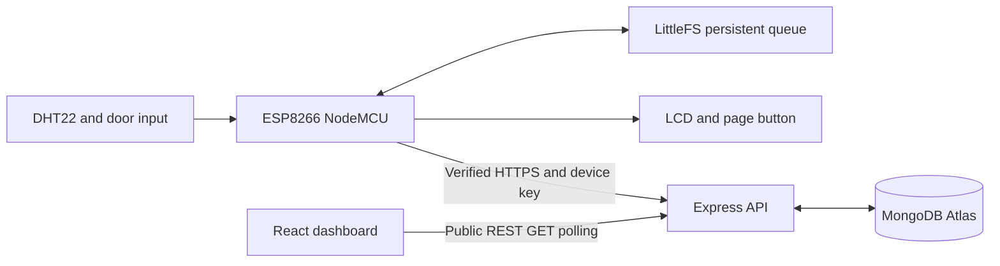

# Smart Cold Storage Monitoring System

An IoT application for monitoring temperature, relative humidity and door activity using ESP8266 NodeMCU, DHT22, LCD1602, Express, MongoDB Atlas and a React dashboard.

## Features

- Temperature, humidity and door-state acquisition, targeting a five-second interval.
- Five LCD pages for environment, door, Wi-Fi, backend/pending uploads and project identification.
- Persistent LittleFS queue, recovery after restart and acknowledged synchronization.
- Stable reading identifiers and duplicate-safe database writes.
- Configurable threshold alerts and a 0–100 environmental risk score.
- Responsive dashboard with historical charts, analytics and a door-open duration timeline.
- Newest-first history table and selectable windows from 25 to 1000 readings.
- Cloud HTTPS communication, authenticated device uploads and public dashboard reads.
- Rolling storage policies for both pending flash readings and database history.

## Live application

- [Dashboard](https://smart-cold-storage-monitoring-system.onrender.com/)
- [Backend health](https://smart-cold-storage-monitoring.onrender.com/)

The backend and dashboard are deployed on Render, with MongoDB Atlas providing persistent storage. Communication uses cloud hostnames, so a laptop server and fixed local IP addresses are not required.

## Architecture



The node samples valid sensor readings approximately every five seconds and commits them locally before upload. The backend stores identified measurements, evaluates fresh readings, tracks door periods and calculates environmental risk. The browser obtains data through REST polling; it does not connect directly to Atlas.

## Hardware and current wiring

| Connection | NodeMCU label | GPIO |
|---|---|---|
| DHT22 DATA | D5 | 14 |
| Door signal | A0 | ADC, threshold 500 |
| LCD RS pin 4 | D1 | 5 |
| LCD E pin 6 | D2 | 4 |
| LCD D4 pin 11 | D4 | 2 |
| LCD D5 pin 12 | D3 | 0 |
| LCD D6 pin 13 | D6 | 12 |
| LCD D7 pin 14 | D7 | 13 |
| Page button | D0 to button to 3V3 | 16 |

The LCD constructor is `LiquidCrystal(D1, D2, D4, D3, D6, D7)`. The external button uses `INPUT_PULLDOWN_16`, active HIGH, with 35 ms debounce. Remove the old D3 button wiring; D3 now carries LCD data. Do not connect D0 to RST in this setup.

Power the bare DHT22 from 3.3 V with common ground and a suitable DATA pull-up. Verify the specific board's A0 input range; the bare ESP8266 ADC is 0–1 V, while NodeMCU boards may have a divider. Never apply 5 V directly to A0 or GPIO. GPIO0 and GPIO2 must retain their boot levels. LCD power, contrast and backlight connections must match the module. Backlight pin 15 connects through a suitable resistor and pin 16 connects to ground.

The five LCD pages show environment, door, Wi-Fi/IP, backend/pending count and the Smart Cold Storage Monitor title. Cooperative servicing improves page-button handling during HTTP activity, but synchronous HTTPS can still delay acquisition. The sampling interval is a scheduling target rather than a hard timing guarantee.

## Repository layout

```text
backend/       Express service, models, storage maintenance and tests
dashboard/     React/Vite UI, Recharts history and analytics
esp8266/       Production sketch, configuration example and storage helpers
```

## Get the source

```bash
git clone https://github.com/sachidanandnc/smart-cold-storage-monitoring.git
cd smart-cold-storage-monitoring
```

## Run the backend locally

1. Install Node.js 22.12 or newer and npm, compatible with the Vite dependency requirements.
2. In `backend`, run `npm ci`. If package.json and its lock file disagree, run `npm install`, review the resulting lock-file change, and commit both together before using `npm ci` in deployment.
3. Copy `backend/.env.example` to `backend/.env` and configure Atlas, thresholds, device ID, a random device key and allowed browser origins.
4. Run `npm start` from `backend`. The default local origin is `http://localhost:5000`.

Production requires `MONGODB_URI`, a `DEVICE_API_KEY` of at least 32 characters and `CORS_ORIGIN`. Configure `DEVICE_ID` consistently with the firmware. Never publish `.env`, `wifi.h`, database passwords or device keys.

Example threshold values in `.env.example` are temperature 2–8 °C, humidity 40–80%, door warning 10 seconds and critical 20 seconds. They are configuration examples, not universal storage requirements or proof of the deployed private settings.

## Run the dashboard locally

From `dashboard`, install with `npm ci`, configure `.env` from its example, then run `npm run dev`. Set `VITE_API_BASE_URL=http://localhost:5000` for a local backend, or the verified cloud backend origin for a cloud connection. Vite embeds this setting at build time: rebuild and redeploy after changing it. Never put an upload key in a `VITE_` variable.

Use `npm run build` for a production bundle in `dist`, `npm run lint` for source checks and `npm test` for the door-activity tests. The dashboard documentation in [dashboard/README.md](dashboard/README.md) explains historical windows and event limits.

## Firmware configuration and upload

Open `esp8266/firmware/firmware.ino` for NodeMCU 1.0 ESP-12E using ESP8266 Arduino Core 3.1.2 and the same 4 MB / 2 MB FS layout used by existing queued data. Install DHT sensor library, Adafruit Unified Sensor, LiquidCrystal and ArduinoJson compatible with the sketch. LittleFS and ESP8266 networking are part of the board core.

Copy `wifi.example.h` to private `wifi.h`. Configure `MY_WIFI_SSID`, `MY_WIFI_PASSWORD`, `CLOUD_API_HOST` (hostname only), `DEVICE_API_KEY`, and a complete PEM root certificate in `SERVER_ROOT_CA`. The main sketch also accepts the older `SERVER_HOST` alias. The key must match the backend. The trust anchor must match a valid chain for the hostname; do not disable TLS verification to make a failed connection succeed.

Use a 2.4 GHz network. Upload the firmware with the existing filesystem layout and without a full flash erase when preserving queued readings. Formatting intentionally deletes the queue. Keep any one-time initializer in its own sketch folder with only one `setup()` and one `loop()`; do not compile multiple initializer sketches together or place them in the production sketch directory. The initializer folder contains separate helper sketches; copy only the selected helper into a clean Arduino sketch folder before using it.

## Offline delivery and time semantics

- A valid reading is written to LittleFS with stable `deviceId` and `readingId` before sending.
- The newest eligible sample gets upload priority; older backlog is sent between new samples. HTTP/TLS reuse reduces repeated connection setup where supported.
- The normal dequeue rule requires HTTP 200/201 and a matching successful `ack` with `stored: true`. Errors and uncertain responses retain the file for retry.
- MongoDB's identity index makes an identical retry idempotent. Reusing an identity for different content is rejected.
- The queue is bounded at 400 files and reserves filesystem space for updates. Actual capacity can be lower because files and metadata consume blocks. At capacity, the selected policy discards the oldest unacknowledged record to preserve newer observations; this is an explicit exception to ACK-based deletion.
- At one sample per five seconds, 400 samples represent about 33 minutes 20 seconds. This is capacity arithmetic, not a measured retention guarantee.
- `capturedAt` describes observation time; `receivedAt` describes backend receipt. UTC is stored; backend console output uses IST. The door timeline explicitly formats IST, while other browser timestamps follow their formatter/browser locale.
- A powered, previously synchronized device can advance its clock through a Wi-Fi outage. A cold boot offline has no trustworthy date. Same-boot unattempted data may be reconstructed from uptime after NTP, within the firmware's bound; capture times that cannot be established remain unknown.
- Unknown-time and historical uploads cannot become current live status or evaluate/resolve active alerts. Older door chronology cannot always be reconstructed after fresh readings have already been processed.

## API and security

| Method | Route | Access |
|---|---|---|
| GET | `/` | Public health |
| POST | `/api/sensor-data` | `X-Device-Key` |
| GET | `/api/sensor-data/latest` | Public |
| GET | `/api/sensor-data/history?limit=N` | Public; default 100, maximum 1000 |
| GET | `/api/risk/current` | Public |
| GET | `/api/door-events` | Public; latest 100 events |
| GET | `/api/alerts?active=true` | Public; recent alerts |

Dashboard reads are public. `DASHBOARD_READ_KEY` is not required or used by the current application. Anyone can read the exposed operational records; CORS is browser response control, not authorization. Uploads remain authenticated. Production uses HTTPS, an 8 KB JSON limit, basic input checks and in-process per-IP rate limits of 900 uploads/minute and 180 API reads/minute. The backend trusts one proxy hop and binds to `0.0.0.0:PORT`.

### Sensor upload format

Readings carry a stable identity and timing information. This example represents a historical upload; a fresh reading uses its current capture time and `historical: false`.

```json
{
  "deviceId": "cold-storage-01",
  "readingId": "example-unique-reading-001",
  "temperature": 5.2,
  "humidity": 65,
  "doorOpen": false,
  "capturedAt": "2026-10-16T10:00:00Z",
  "timeQuality": "ntp",
  "historical": true
}
```

Send the credential in the `X-Device-Key` header. Successful storage returns an acknowledgement with the matching `deviceId`, `readingId` and `stored: true`. An identical retry is acknowledged as a duplicate; changed content using the same identity is rejected. When capture time is unknown, use `timeQuality: "unknown"` and `capturedAt: null`.

## Risk and door activity

The score is capped at 100. Temperature outside the configured interval adds 20, 35 or 55 points for deviations up to 2 °C, up to 5 °C or above 5 °C. Humidity outside the interval adds 8, 14 or 20 points for deviations up to 10, up to 20 or above 20 percentage points. A currently open door adds 5 below the warning time, 15 from warning to below critical, and 25 at or above critical. Closed adds zero. Levels are LOW 0–24, MEDIUM 25–49, HIGH 50–74 and CRITICAL 75–100.

This is an environmental rule score. It represents configured environmental conditions rather than product spoilage. The backend creates and resolves active alerts from fresh eligible readings; historical replay contributes to stored history.

Completed door-event records still count as openings. Uncertain periods are excluded from exact duration totals without disappearing from the opening count. The duration chart rises with observed open time and resets at a supported close. Short physical openings between transmitted observations may be missed. Unclosed periods stop at the last supported observation, rather than extending indefinitely to browser time.

## Storage and cloud operation

Atlas history is rolling rather than retained forever. Every 30 seconds the backend checks cluster size, with default high/low watermarks of 420/380 MiB. Above the high mark it removes old completed readings in batches until space falls below the low mark. It protects the latest eligible reading, unfinished processing and recent receipts. If no eligible sensor records remain, old resolved alerts and closed events can be pruned. This is not a fixed-age TTL and cannot guarantee headroom when other cluster data or a failed maintenance command consumes the quota.

Render backend settings: root `backend`, install dependencies with a synchronized lock file, start `node server.js`, set production environment variables. Static-site settings: root `dashboard`, build `npm ci && npm run build`, publish `dist`, configure `VITE_API_BASE_URL` as the backend HTTPS origin. Set backend `CORS_ORIGIN` to the exact dashboard origin without a trailing slash. Auto-deploy requires the service's GitHub connection, selected branch and auto-deploy setting to be enabled; a local commit alone is not a push.

Free hosting has idle sleep, restart and quota limitations. The queue handles temporary failures within finite capacity; it does not provide unlimited lossless logging or guaranteed availability. See current [Render Free documentation](https://render.com/docs/free) and [Atlas Free limits](https://www.mongodb.com/docs/atlas/reference/free-shared-limitations/).

## Verification and documentation

From `backend`: `npm run check` and `npm test`. From `dashboard`: `npm test`, `npm run lint`, `npm run build`. These software checks do not calibrate hardware. The backend tests use mocked storage/local services rather than writing test samples to deployed Atlas.

Automated checks cover acknowledged delivery, duplicate handling, historical/live separation, timestamps, door chronology, API access and rolling storage. Dashboard tests cover event counts, durations, uncertainty and record ordering. Hardware checks include valid sensor readings, both door states, LCD page navigation, offline startup, queued-data recovery after reboot and synchronization after reconnecting.

## Author

**Sachidanand N C**
Computer Science and Engineering
RV Institute of Technology and Management, Bengaluru

[GitHub profile](https://github.com/sachidanandnc)

## License

No license file is currently included in this repository.
